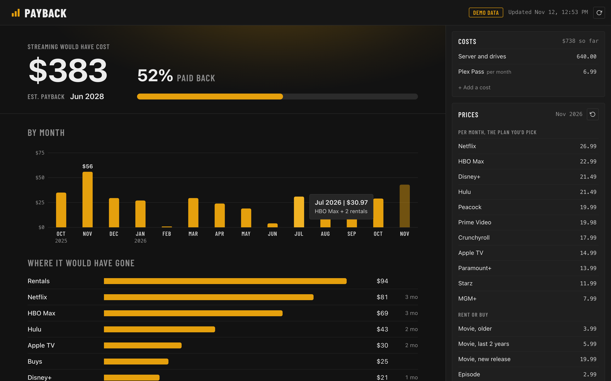

# Payback

What everything you've watched on Plex would have cost on streaming services, and how far that has paid back your server.

Payback reads your Plex watch history, looks up where each title streams, and prices every play the cheapest realistic way: a month of the service a show is on, a rental for a one-off movie, or buying the episodes of a show no service carries. You put in what your setup cost, and it shows how much of that has paid for itself.



- **Monthly chart:** what each month would have cost, and which services you'd have paid for.
- **Breakdown:** spending per service, plus rentals and purchases.
- **Ledger:** every 30-day subscription with what you watched during it, every rental and every purchase.
- **Payback:** how much of your hardware, Plex Pass and other costs streaming would already have paid for, and the month it should be fully paid off.
- **Your own numbers:** costs and prices are editable in the page, and everything is repriced when you change one.

It's a single small Go program with no dependencies. It refreshes once a night, keeps its data in one folder, and only talks to your Plex server and TMDB.

## How plays are priced

- **Shows:** the first episode starts a 30-day subscription to the cheapest service carrying the show. It renews only if something on that service is watched after it ends, so a binge costs one month and a show watched over a year costs every month it was watched.
- **Movies:** free if a service that has the movie is already running that month. Otherwise it's the cheaper of renting the movie or starting a service that has it. Exclusives that can't be rented start their service.
- **Rental prices** depend on age when watched: older than 2 years, within 2 years, or in the first 120 days (premium video on demand).
- **Shows no service carries** are bought by the episode, capped at the season price.
- **Repeats:** each movie counts once, since repeat plays are mostly scrubbing or glitches.
- **Timing:** charges count in the month they start.

Where things stream comes from TMDB's watch providers (data by JustWatch) for your region. The default US prices are each service's top ad-free 4K plan as of November 2026. Change them to the plans you'd actually pick.

## Quick start

You need Docker, a Plex token and a TMDB token.

1. **Plex token:** follow Plex's guide, [Finding an authentication token](https://support.plex.tv/articles/204059436-finding-an-authentication-token-x-plex-token/).
2. **TMDB token:** create a free account at [themoviedb.org](https://www.themoviedb.org/signup), then copy the **API Read Access Token** from [Settings → API](https://www.themoviedb.org/settings/api).
3. Save [`compose.yaml`](compose.yaml), fill in your Plex address and the two tokens, and start it:

   ```sh
   docker compose up -d
   ```

4. Open `http://<server>:8095`. The first run reads your whole history, which can take a few minutes for a big library.

Then fill in **Costs** on the right: your server and drives (paid once), Plex Pass (per month or once for lifetime), a VPN, electricity, and so on. Each cost can have the month it started and ended.

### Try it without Plex

```sh
docker run --rm -p 8095:8095 -e DEMO=1 ghcr.io/rmahshie/plex-payback
```

That serves a made-up year of watching, like the screenshot above.

### Without Docker

```sh
go build -o payback .
PLEX_URL=http://localhost:32400 PLEX_TOKEN=… TMDB_TOKEN=… ./payback
```

This needs Go 1.24 or newer. Data goes in `./data` unless you set `DATA_DIR`.

## Settings

| Variable | Default | |
| --- | --- | --- |
| `PLEX_URL` | | Your Plex server, e.g. `http://192.168.1.10:32400` |
| `PLEX_TOKEN` | | Plex token |
| `PLEX_PREFS` | | Instead of `PLEX_TOKEN`: path to Plex's `Preferences.xml`. Payback reads the token from it on each refresh, which is handy when it runs on the Plex machine. Mount the file read-only. |
| `TMDB_TOKEN` | | TMDB API Read Access Token |
| `REGION` | `US` | Two-letter country code for streaming availability and default prices |
| `TZ` | system | Time zone used to count months, e.g. `Europe/London` |
| `APP_PASSWORD` | | If set, the page asks for it. Any user name works. |
| `LISTEN` | `:8095` | Address to listen on |
| `DATA_DIR` | `data` (`/data` in Docker) | Where settings and caches are kept |
| `DEMO` | | Set to `1` to serve made-up data |

Everything else lives in `settings.json` in the data folder. The page edits most of it; a few things are only in the file:

- **`account`:** whose plays count. `1` is the server owner, which is the default. `0` counts everyone. For someone else, use their account ID from `http://<plex>:32400/accounts?X-Plex-Token=<token>`.
- **`currency`:** a three-letter code such as `USD` or `EUR`. It's guessed from `REGION`.
- **`manual`:** things watched before Plex, so they count too:

  ```json
  "manual": [
    { "kind": "movie", "title": "Groundhog Day", "year": 1993, "month": "2025-12" },
    { "kind": "tv", "title": "Mad Men", "seasons": [1, 2], "month": "2025-11" }
  ]
  ```

  A show without `seasons` counts every season. If a title matches the wrong thing, add `"tmdb": "<id>"` from its TMDB URL. Press refresh at the top of the page after editing the file.

### Outside the US

Set `REGION`. Plans start empty, and the services your titles are on show up under **Not priced yet**. Type a price next to each one you'd pay for. Until a service has a price, its titles are priced as rentals or purchases. Rental and purchase prices start at the US numbers, so adjust them too.

## Privacy

Your history, settings and results stay in the data folder. Payback sends TMDB only title IDs, plus a title name and year when it has to search for something no longer in your library. Nothing else leaves your network.

## Credits

- Release dates and streaming availability come from [TMDB](https://www.themoviedb.org) and [JustWatch](https://www.justwatch.com). This product uses the TMDB API but is not endorsed or certified by TMDB.
- Not affiliated with or endorsed by Plex.
- Barlow Condensed is by Jeremy Tribby, under the [SIL Open Font License](web/fonts/OFL.txt).

## License

[MIT](LICENSE)
